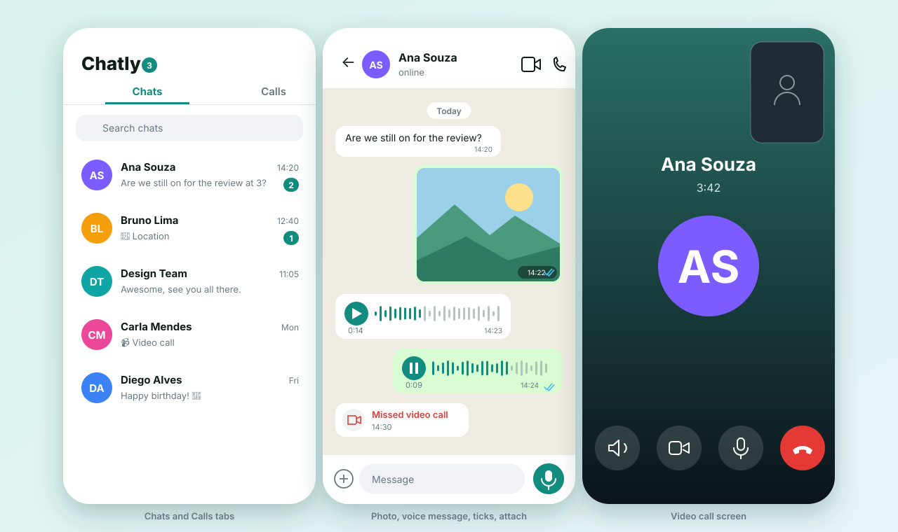

# 💬 Flutter Chat UI

<p align="center"></p>

<sub>Preview: design illustration of the screens, in the light theme. Run the app to see the real thing.</sub>

A free Flutter template for a modern chat app: conversation list, live search, message threads with day separators and a typing indicator. Material 3, light and dark themes, **no third-party packages**. It is the Flutter twin of [Chatly for React](https://github.com/lenivalestevao/react-chat-ui).

## Features

- **Conversations**: avatars, last message preview, time and unread badges, most recent first
- **Search**: filters by name or message text as you type
- **Thread**: bubbles for you and for them, day separators (Today, Yesterday, dates) and timestamps
- **Composer**: send with the button or the keyboard, blank messages are ignored
- **Typing indicator**: animated dots and a simulated reply, so the demo feels alive
- **Adaptive**: two panes on tablets, desktop and web; list, then thread on phones
- Light and dark themes generated from one seed color, with a toggle in the app

## Modern Flutter / Dart used

- Dart 3: `for` and `if` inside collection literals, immutable models, `final` everywhere
- Material 3: `IconButton.filled`, `ColorScheme.fromSeed`, `surfaceContainer*` roles
- `Color.withValues` (no deprecated APIs)
- State with a plain `ChangeNotifier` exposed by a tiny `ChatScope` (`InheritedNotifier`); injectable clock, reply delay and random source for tests

## Run it

```bash
flutter create . --platforms=android,ios,web
flutter pub get
flutter run
```

`flutter create .` only adds the platform folders. It keeps the `lib/` and `pubspec.yaml` of this repo. Needs Flutter 3.32 or newer. Run the tests with `flutter test`.

## Structure

| Path | Purpose |
|---|---|
| `lib/main.dart` | App entry, theme and store |
| `lib/core/` | Theme, formatting helpers, `ChatScope`, avatar, badge and typing dots |
| `lib/data/models.dart` | `Message` and `Conversation` |
| `lib/data/chat_store.dart` | State: search, sort, unread, send, simulated reply, theme |
| `lib/data/seed.dart` | Demo conversations and canned replies |
| `lib/features/` | Home shell (adaptive), conversations pane and chat pane |
| `test/chat_test.dart` | Logic and UI tests |

## Make it yours

1. Change `brand` in `lib/core/theme.dart` and the name in `lib/main.dart`.
2. Edit the demo data in `lib/data/seed.dart`, or start empty with `ChatStore(demo: false)`.
3. Connect a real backend: replace the `Timer` in `ChatStore.send` with your API or WebSocket and call `_append` when a message arrives.
4. Save chats between launches with `shared_preferences` or a local database.
5. Prefer Riverpod or Bloc? Replace `ChatScope` and `ChatStore`; the widgets read state in one line each.

## License

MIT. Free for personal and commercial use.
